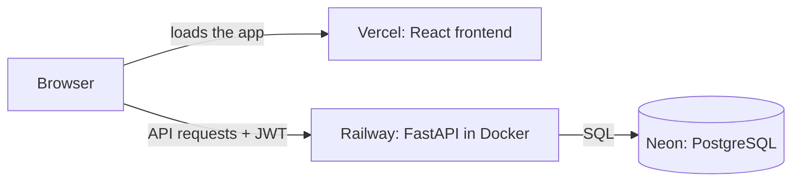

# Timesheet
Timesheet is a webapp designed for workers whose job sites do not have a time clock so they can calculate their hours; 
hours are computed from the timestamps.

🔗 **Live demo:** [timesheet-six-nu.vercel.app](https://timesheet-six-nu.vercel.app)

## Why I built this
The problem I was trying to solve: my friends who work at construction sites have no access to time clocks, so they calculate their hours on paper, which is prone to calculation errors and sometimes forgotten.

The solution: Timesheet records their hours using timestamps posted at clock in/out. It is kept very minimal on purpose, as workers mainly want to log in, post a shift, and view the hours they have worked.

## Features and Roadmap
**Workers**
- [x] Register for an account and log in with a username and password
- [x] Clock in and clock out using timestamp buttons
- [x] View hours worked
- [x] View a breakdown of hours by calendar dates on the dashboard
- [x] View worker ID on the account page
- [x] Delete account at any time

**Admins**
- [x] View all registered workers
- [x] View workers' hours
- [x] Change workers' hours

**Coming next**
- [ ] Pay calculation
- [ ] Download hours as a PDF

## Tech stack
- **Backend:** FastAPI, Pydantic
- **Auth:** JWT tokens; passwords hashed with bcrypt
- **Database:** PostgreSQL (B-tree indexes on primary key and username)
- **Frontend:** React, JavaScript
- **Deployment:** Docker · Railway (backend) · Vercel (frontend) · Neon (database)

## Architecture
